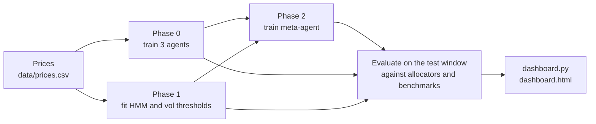

# Hierarchical RL for Trading

Master's thesis project: a two-level reinforcement learning system that trades the
Dow Jones Index (`^DJI`) on daily bars.

- **Low level:** three frozen SAC agents with different risk profiles (aggressive,
  balanced, conservative). Each outputs a position in `[-1, 1]`, scaled by its own cap.
- **High level:** an allocator that decides how much capital each agent gets. Rule-based
  allocators are the baselines; the contribution is a SAC meta-agent that sees an HMM
  regime posterior, market features and the agents' proposals and recent performance.



| Phase | What is built | Script | Output |
|---|---|---|---|
| 0 | Three agents on a risk ladder | `train_agents.py` | `models/<name>_agent/` |
| 1 | Equal Weight, Vol Regime and HMM allocators (no learning at this level) | `train_phase1.py` | `models/phase1/` |
| 2 | Meta-RL allocator with a cash arm, vol-target overlay and Differential Sharpe reward | `train_phase2.py` | `models/phase2/` |
| Eval | All of the above against Buy & Hold and vol-targeted Buy & Hold | `evaluate_phase2.py` | `phase2_*.csv` |

`run_all.py` runs all four in order, so you rarely need the individual scripts.

## Quick start

Commands assume macOS or Linux. On Windows, activate the environment with
`.venv\Scripts\activate` instead.

### 1. Get the code

```bash
git clone https://github.com/chillMLguy/HRL-for-trading-.git
cd HRL-for-trading-
```

### 2. Create an environment and install

You need Python 3.10 or newer. This setup was tested on Python 3.13.

```bash
python3 -m venv .venv
source .venv/bin/activate
pip install -r requirements.txt
```

### 3. Check the installation

```bash
python tests/test_envs.py
python tests/test_dashboard.py
```

Every line should start with `✓`. These take under a minute and need no training.

### 4. Look at the existing results

```bash
python dashboard.py
```

This writes `dashboard.html`. Open it in a browser, for example `open dashboard.html` on
macOS. It reads the CSV files already in `runs/`, so nothing is trained.

### 5. Run the pipeline end to end

Run this once on a new machine to confirm that training works. It trains all three phases
with a small budget, then evaluates them on 2024. Results go to `runs/latest/`, which git
ignores.

```bash
python run_all.py --quick
python dashboard.py
```

Prices come from `data/prices.csv`, which is in the repo, so no download is needed.

### 6. Run a full experiment

One split, with the defaults from `config.py` (train 2013–2023, test 2024):

```bash
python run_all.py --outdir runs/split2024 --full
```

To use other dates:

```bash
python run_all.py --outdir runs/split2022 --full \
    --train_start 2011-01-01 --train_end 2021-12-31 \
    --test_start 2022-01-01 --test_end 2022-12-31
```

### 7. Run the walk-forward experiment

This is the experiment the thesis conclusions should rest on: every test year in
`config.WF_TEST_YEARS`, each trained on the previous 8 years, for each seed in
`config.WF_SEEDS`.

```bash
python walk_forward.py --outroot runs/wf --steps0 200000 --steps2 150000
python aggregate_results.py --root runs/wf
python dashboard.py
```

A finished fold and seed is skipped when you rerun, so you can stop and resume at any time.
Try a small grid first:

```bash
python walk_forward.py --outroot runs/wf_try --years 2022 2024 --seeds 0 \
    --steps0 30000 --steps2 30000
```

The dashboard pools each walk-forward folder into one entry in its run selector.

### 8. Run the ablation studies

Use the same grid with one feature removed, each in its own folder:

```bash
python walk_forward.py --outroot runs/wf_nocash    --no_cash
python walk_forward.py --outroot runs/wf_novol     --vol_target 0
python walk_forward.py --outroot runs/wf_composite --meta_reward composite
python walk_forward.py --outroot runs/wf_nohmm     --no_hmm
```

## The dashboard

`python dashboard.py` is the only plotting command. It searches `runs/` and writes one
self-contained file that opens with no server and no internet.

| Section | Contents |
|---|---|
| Overview | Headline numbers, a plain-language result with significance, all runs side by side |
| Walk-forward | Pooled Sharpe with CI, PSR and Deflated Sharpe, Sharpe per test year, seed dispersion, paired tests |
| Single agents | Metrics, equity, drawdown, maximum drawdown, rolling Sharpe, return distribution, return correlation, exposure ladder, Sharpe by regime, positions |
| Model testing | Metrics, equity, Sharpe with confidence intervals, drawdown, maximum drawdown, Meta-RL relative to each alternative, rolling Sharpe, rolling volatility, return distribution, return correlation, agent weights, weights by regime, meta-agent diagnostics, executed vs. proposed positions, positions by allocator, Sharpe by regime, period returns, paired tests |
| Run details | Training configuration, validation vs. test Sharpe, formula notes |

Useful options:

```bash
python dashboard.py --runs runs/split2024       # one run only
python dashboard.py --out thesis_2024.html      # another output file
python dashboard.py --window 120                # rolling window in days
```

To save a figure for the thesis, switch the page to the light theme and click the camera
icon on the chart. It saves a PNG at three times screen resolution.

## Repository layout

```
config.py              All defaults: dates, costs, agent presets, meta-agent, walk-forward grid
run_all.py             One split, end to end
walk_forward.py        Rolling folds × seeds; resumable
aggregate_results.py   Pooled walk-forward statistics and tests
dashboard.py           All charts → dashboard.html

train_agents.py        Phase 0: train the agents
train_phase1.py        Phase 1: fit the HMM and vol thresholds
train_phase2.py        Phase 2: train the meta-agent
evaluate_agents.py     Phase 0 evaluation; also holds the benchmark functions
evaluate_phase1.py     Phase 1 evaluation; also holds run_allocator
evaluate_phase2.py     Full head-to-head; writes the CSVs the dashboard reads

download_data.py       Refresh data/prices.csv
pretrain_cnn.py        Optional CNN features (off unless you run this)

env/                   TradingEnv, MetaTradingEnv, shadow books, CNN model
regime/                HMM detector and rule-based allocators
common/                Price loading, statistics, validation-Sharpe callback
tests/                 Mechanical checks of the environments and the dashboard
data/prices.csv        ^DJI daily closes, so every run uses identical data
runs/                  Results, one folder per experiment
CHANGES.md             Why the environments and rewards look the way they do (F1–F12, R1–R7)
```

Each run folder holds these files:

| File | Contents |
|---|---|
| `phase2_returns.csv` | Daily net returns per strategy, with dates |
| `phase2_equity_curves.csv` | Equity per strategy |
| `phase2_weights.csv` | Daily agent weights per allocator, plus cash and leverage for Meta-RL |
| `phase2_actions.csv` | Executed position and each agent's proposed position, per day |
| `phase2_metrics.csv` | Summary metrics per strategy |
| `phase2_eval_config.json` | Exactly how the evaluation was run |
| `models/*/config.json` | Exactly how each model was trained |

## Trained models are not in git

Git tracks code, prices, result CSVs and configs. Model files (`*.zip`, `*.pkl`, `*.pt`) and
TensorBoard logs are ignored. They stay on the machine that trained them under
`runs/<name>/models/` and `runs/<name>/logs/`.

- The dashboard needs only the CSVs, so it works on a fresh clone.
- Re-evaluating a run needs its models, so train them first, or copy the folder from the
  machine that has them.
- Older committed models and results are still in git history. To restore some:

  ```bash
  git checkout ebd3b23 -- split2024/models
  ```

## Configuration

Most experiments only need `config.py` or a command-line flag.

| What | Where |
|---|---|
| Training and test dates | `TRAIN_START`, `TRAIN_END`, `TEST_START`, `TEST_END`, or `run_all.py` flags |
| Transaction cost | `COST_PCT`, or `--cost_pct` |
| Risk ladder | `AGENT_PRESETS`: `lam_var`, `max_pos`, `dd_free`, `dd_max` per agent |
| Meta-agent | `META_USE_CASH`, `META_REWARD`, `VOL_TARGET`, `VOL_TARGET_CAP` |
| HMM | `N_STATES`, `HMM_EMBARGO` |
| Walk-forward grid | `WF_TEST_YEARS`, `WF_TRAIN_YEARS`, `WF_SEEDS` |

Training budget:

| Flag | Agent steps | Meta-agent steps | Network |
|---|---|---|---|
| `--quick` | 50,000 | 40,000 | `[64, 64]` |
| no flag | 200,000 | 150,000 | `[128, 128]` |
| `--full` | 500,000 | 300,000 | `[256, 256]` |
| `--steps0 N --steps2 M` | N | M | `[128, 128]` |

## Good to know

- **Refreshing prices:** `python download_data.py` overwrites `data/prices.csv`. Do this
  between experiments, not during one, because Yahoo adjusts history over time.
- **Benchmarks:** judge the model against vol-targeted Buy & Hold (`vol_target_bh`) as well as
  plain Buy & Hold. Volatility targeting alone tends to improve an index's Sharpe.
- **One test year proves little:** the 95% interval on a one-year Sharpe spans about ±2. Rely
  on the walk-forward results and the paired tests when drawing conclusions.
- **CNN features are off by default.** Their observation slots hold zeros unless a run
  folder contains `models/cnn_features/cnn_model.pt`. To use them, train on that run's training
  window only, or the features leak test data:

  ```bash
  python pretrain_cnn.py --outdir runs/mycnn --start 2013-01-01 --end 2023-12-31
  python run_all.py --outdir runs/mycnn --full
  ```

- **Running several trainings in parallel:** set `OMP_NUM_THREADS=1` for each so they don't
  compete for CPU threads.
- **Inspecting training:** `tensorboard --logdir runs/split2024/logs`.
