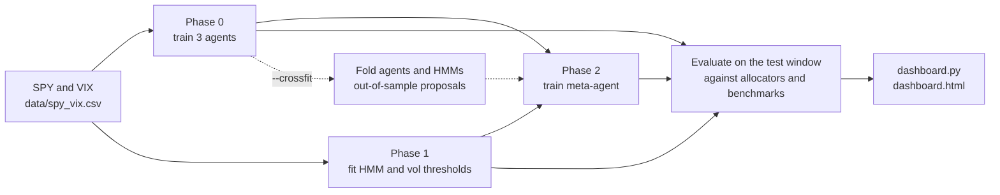

# Hierarchical RL for Trading

Master's thesis project: a two-level reinforcement learning system that trades the
SPY ETF on daily bars, with the VIX index as an extra input to every model.

This is branch `spy-vix`. Earlier branches traded the Dow Jones Index (`^DJI`) with 2 bp
costs and no VIX. The changes are listed at the end of [CHANGES.md](CHANGES.md).

- **Low level:** three frozen SAC agents with different risk profiles (aggressive,
  balanced, conservative). Each outputs a position in `[-1, 1]`, scaled by its own cap.
- **High level:** an allocator that decides how much capital each agent gets. Rule-based
  allocators are the baselines; the contribution is a SAC meta-agent that sees an HMM
  regime posterior, market features and the agents' proposals and recent performance.



| Phase | What is built | Script | Output |
|---|---|---|---|
| 0 | Three agents on a risk ladder | `train_agents.py` | `models/<name>_agent/` |
| 1 | Equal Weight, Vol Regime and HMM allocators (no learning at this level) | `train_phase1.py` | `models/phase1/` |
| 2 | Meta-RL allocator with a cash arm, vol-target overlay and Differential Sharpe reward | `train_phase2.py` | `models/phase2/` |
| Eval | All of the above against Buy & Hold and vol-targeted Buy & Hold | `evaluate_phase2.py` | `phase2_*.csv` |

`run_all.py` runs all four in order, so you rarely need the individual scripts.

## Quick start

Commands assume macOS or Linux. On Windows, activate the environment with
`.venv\Scripts\activate` instead.

### 1. Get the code

```bash
git clone https://github.com/chillMLguy/HRL-for-trading-.git
cd HRL-for-trading-
```

### 2. Create an environment and install

You need Python 3.10 or newer. This setup was tested on Python 3.13. PyTorch makes the
install large: about 5.6 GB on Linux.

```bash
python3 -m venv .venv
source .venv/bin/activate
pip install -r requirements.txt
```

### 3. Download SPY and VIX

```bash
python download_data.py
```

This writes `data/spy_vix.csv` with columns `Date`, `SPY` and `^VIX` from 1993 on (SPY's
first trading day was 29 January 1993), in one Yahoo request. The default training window
starts on 1 February 1993, so a file that starts later is refused rather than silently
shortening the window. Commit and push it, so every machine and every rerun uses the same data:

```bash
git add data/spy_vix.csv
git commit -m "SPY and VIX data"
git push
```

If the download fails, any CSV with those three columns works: `SPY` as dividend-adjusted
closes, `^VIX` as closes.

### 4. Check the installation

```bash
python tests/test_envs.py
python tests/test_crossfit.py
python tests/test_dashboard.py
python tests/test_vix.py
python tests/test_training.py
```

Every line should start with `✓`. These take a minute or two and need no real training.

### 5. Look at the existing results

```bash
python dashboard.py
```

This writes `dashboard.html`. Open it in a browser, for example `open dashboard.html` on
macOS. It reads the CSV files already in `runs/`, so nothing is trained. The runs already
in the repo are `^DJI` runs from earlier branches.

### 6. Run the pipeline end to end

Run this once on a new machine to confirm that training works. `--quick` trains every
model for only 3 passes over its training days, then evaluates on 2024. It checks the
mechanics; its numbers are not results. Output goes to `runs/latest/`.

```bash
export OMP_NUM_THREADS=1
python run_all.py --quick
python dashboard.py --runs runs/latest
```

Keep `OMP_NUM_THREADS=1` for all training: on a 2-core machine a small walk-forward cell ran
more than 5 times faster than with the default threading.

Prices and VIX come from `data/spy_vix.csv` (step 3).

### 7. Run a full experiment

One split, with the defaults from `config.py` (train February 1993 to 2023, test 2024):

```bash
python run_all.py --outdir runs/split2024 --crossfit
```

To use other dates:

```bash
python run_all.py --outdir runs/split2022 --crossfit \
    --train_end 2021-12-31 --test_start 2022-01-01 --test_end 2022-12-31
```

See [Network size and training length](#network-size-and-training-length) for the defaults
and how to change them.

### 8. Run the walk-forward experiment

This is the experiment the thesis conclusions should rest on: every test year in
`config.WF_TEST_YEARS`, for each seed in `config.WF_SEEDS`. Each fold trains on everything
from February 1993 to the end of the year before its test year (an expanding window).
`--train_years 8` slides instead, training on the 8 years before each test year.

```bash
python walk_forward.py --outroot runs/wf --crossfit
python aggregate_results.py --root runs/wf
python dashboard.py --runs runs/wf
```

A finished fold and seed is skipped when you rerun, so you can stop and resume at any time.
Try a small grid first:

```bash
python walk_forward.py --outroot runs/wf_try --crossfit --years 2022 2024 --seeds 0
```

The dashboard pools each walk-forward folder into one entry in its run selector.

### 9. Train the meta-agent on out-of-sample behaviour

By default the meta-agent trains on days the agents were fitted to, so it sees them
performing far better than they will on new data. With `--crossfit` it learns only from what
agents do on data they haven't seen:

```bash
python run_all.py --outdir runs/crossfit_2024 --crossfit
python walk_forward.py --outroot runs/wf_crossfit --crossfit
```

This retrains the agents and HMM once per fold (`config.CF_FOLDS`, 4 by default). The fold
agents use the same network and passes as the final agents, on shorter windows, so Phase 0
takes about three times as long.

Each run also trains a second meta-agent on the same dates, budget and seed using the final
agents' in-sample behaviour. It is evaluated on the same test path as `meta_rl_leaked`, so
the dashboard's paired test measures the effect of the leak directly. Skip it with
`--no_compare_leaked`.

One seed can decide that comparison, so retrain only the meta-agents across seeds, with the
agents held fixed. Each new meta-agent copies the network, weight decay and steps of the
run's own meta-agent, so only the seed differs:

```bash
python meta_seed_study.py --rundir runs/crossfit_2024 --seeds 0 1 2 3
```

Its results are printed and saved in `<rundir>/meta_seed_study.csv`; the dashboard does not
show them.

Cross-fitting assumes retrained agents behave like the final ones. To check that on the run's
test year:

```bash
python agent_stability.py --rundir runs/crossfit_2024
```

### 10. Run the ablation studies

Use the same grid with one feature removed, each in its own folder:

```bash
python walk_forward.py --outroot runs/wf_novix     --no_vix
python walk_forward.py --outroot runs/wf_vixlag0   --vix_lag 0
python walk_forward.py --outroot runs/wf_nocash    --no_cash
python walk_forward.py --outroot runs/wf_novol     --vol_target 0
python walk_forward.py --outroot runs/wf_composite --meta_reward composite
python walk_forward.py --outroot runs/wf_nohmm     --no_hmm
```

`run_all.py` takes the same flags for one split.

## VIX inputs

Every agent and the meta-agent see four VIX features next to the price features:

| Input | Definition | What it says |
|---|---|---|
| `vix_level` | ln(VIX / 20) | Expected volatility relative to its long-run norm |
| `vix_rel` | ln(VIX / median VIX of the previous 252 days) | Fear relative to the past year |
| `vix_chg` | ln(VIX today / VIX 5 days ago) | A volatility shock building or fading |
| `vrp` | VIX / 100 − realized 20-day volatility | Variance risk premium: implied minus realized |

- **Timing.** VIX closes at 4:15 pm ET, 15 minutes after SPY. A decision at SPY's close
  therefore uses the previous day's VIX by default (`VIX_LAG_DAYS = 1`). `--vix_lag 0` uses
  the same day's close, which is slightly optimistic.
- **Ablation.** `--no_vix` sets the four inputs to zero and keeps the observation size, so
  the two runs differ only in the information the models get.
- **Safety.** Each model's `config.json` records `use_vix` and `vix_lag_days`. Every script
  that loads a model refuses one trained with other settings. To run a single script on a
  `--no_vix` run, prefix it, for example `HRL_USE_VIX=0 python evaluate_phase2.py ...`.
- The agents see 24 inputs (20 before this branch). Models trained on earlier branches can't
  be loaded here; their CSVs still show in the dashboard.

## The dashboard

`python dashboard.py` is the only plotting command. It searches `runs/` and writes one
self-contained file that opens with no server and no internet.

| Section | Contents |
|---|---|
| Overview | Headline numbers, a plain-language result with significance, all runs side by side |
| Walk-forward | Pooled Sharpe with CI, PSR and Deflated Sharpe, Sharpe per test year, seed dispersion, paired tests |
| Single agents | Metrics, equity, drawdown, maximum drawdown, rolling Sharpe, return distribution, return correlation, exposure ladder, Sharpe by regime, positions |
| Model testing | Metrics, equity, Sharpe with confidence intervals, drawdown, maximum drawdown, Meta-RL relative to each alternative, rolling Sharpe, rolling volatility, return distribution, return correlation, agent weights, weights by regime, meta-agent diagnostics, executed vs. proposed positions, positions by allocator, Sharpe by regime, period returns, paired tests |
| Overfitting check | Every model's Sharpe on its training, validation and test data, with a warning when a training Sharpe is implausibly high |
| Run details | Training configuration, validation vs. test Sharpe, formula notes |

Useful options:

```bash
python dashboard.py --runs runs/split2024       # one run only
python dashboard.py --out thesis_2024.html      # another output file
python dashboard.py --window 120                # rolling window in days
```

The overfitting check reads `window_sharpe.csv`, which `run_all.py` and `walk_forward.py`
now write for every run. For a run trained before this existed, create it on the machine that
holds the model files:

```bash
python overfit_check.py --rundir runs/latest
```

To save a figure for the thesis, switch the page to the light theme and click the camera
icon on the chart. It saves a PNG at three times screen resolution.

## Repository layout

```
config.py              All defaults: dates, costs, agent presets, meta-agent, walk-forward grid
run_all.py             One split, end to end
walk_forward.py        Rolling folds × seeds; resumable
aggregate_results.py   Pooled walk-forward statistics and tests
dashboard.py           All charts → dashboard.html

train_agents.py        Phase 0: train the agents
train_phase1.py        Phase 1: fit the HMM and vol thresholds
train_phase2.py        Phase 2: train the meta-agent
train_crossfit.py      Out-of-sample proposal stream for --crossfit
evaluate_agents.py     Phase 0 evaluation; also holds the benchmark functions
evaluate_phase1.py     Phase 1 evaluation; also holds run_allocator
evaluate_phase2.py     Full head-to-head; writes the CSVs the dashboard reads
overfit_check.py       Each model on its training and validation data
meta_seed_study.py     Cross-fitted vs. leaked meta-agents across seeds, agents held fixed
agent_stability.py     Fold agents vs. final agents on the test year

download_data.py       Download SPY and VIX into data/spy_vix.csv
pretrain_cnn.py        Optional CNN features (off unless you run this)

env/                   TradingEnv, MetaTradingEnv, shadow books, CNN model
regime/                HMM detector and rule-based allocators
common/                Price loading, statistics, validation-Sharpe callback, cross-fit folds
tests/                 Mechanical checks of the environments and the dashboard
data/spy_vix.csv       SPY and VIX daily closes, so every run uses identical data
data/prices.csv        ^DJI daily closes used by earlier branches
runs/                  Results, one folder per experiment
CHANGES.md             Why the environments and rewards look the way they do (F1–F12, R1–R7)
```

Each run folder holds these files:

| File | Contents |
|---|---|
| `phase2_returns.csv` | Daily net returns per strategy, with dates |
| `phase2_equity_curves.csv` | Equity per strategy |
| `phase2_weights.csv` | Daily agent weights per allocator, plus cash and leverage for Meta-RL |
| `phase2_actions.csv` | Executed position and each agent's proposed position, per day |
| `phase2_metrics.csv` | Summary metrics per strategy |
| `phase2_eval_config.json` | Exactly how the evaluation was run |
| `window_sharpe.csv` | Sharpe of each model on its training and validation data |
| `crossfit/proposals.csv` | With `--crossfit`: the out-of-sample proposals the meta-agent trained on |
| `meta_seed_study.csv` | From `meta_seed_study.py`: validation and test Sharpe per seed |
| `agent_stability.csv` | From `agent_stability.py`: test Sharpe and action correlation per agent set |
| `models/*/config.json` | Exactly how each model was trained |

## Trained models are not in git

Git tracks code, prices, result CSVs and configs. Model files (`*.zip`, `*.pkl`, `*.pt`) and
TensorBoard logs are ignored. They stay on the machine that trained them under
`runs/<name>/models/` and `runs/<name>/logs/`.

- The dashboard needs only the CSVs, so it works on a fresh clone.
- Re-evaluating a run needs its models, so train them first, or copy the folder from the
  machine that has them.
- Older committed models and results are still in git history. To restore some:

  ```bash
  git checkout ebd3b23 -- split2024/models
  ```

## Configuration

Most experiments only need `config.py` or a command-line flag.

| What | Where |
|---|---|
| Training and test dates | `TRAIN_START`, `TRAIN_END`, `TEST_START`, `TEST_END`, or `run_all.py` flags |
| Asset and data file | `TICKER`, `VIX_TICKER`, `DATA_CSV`, or `--ticker`, `--data_csv` |
| Transaction cost | `COST_PCT` (0.2 bp), or `--cost_pct` |
| VIX inputs | `USE_VIX`, `VIX_LAG_DAYS`, or `--no_vix`, `--vix_lag` |
| Risk ladder | `AGENT_PRESETS`: `lam_var`, `max_pos`, `dd_free`, `dd_max` per agent |
| Meta-agent | `META_USE_CASH`, `META_REWARD`, `VOL_TARGET`, `VOL_TARGET_CAP` |
| HMM | `N_STATES`, `HMM_EMBARGO` |
| Walk-forward grid | `WF_TEST_YEARS`, `WF_TRAIN_YEARS`, `WF_SEEDS` |
| Cross-fitting | `CF_FOLDS`, `CF_MIN_TRAIN_FRAC`, `META_TRAIN_EPISODE_BARS` |

## Network size and training length

A few thousand training days can't support large networks. On ^DJI, 500k steps with a
`[256, 256]` network reached a training Sharpe of 5 to 9 and a test Sharpe below 0. The
defaults are therefore small networks, weight decay, and a training length counted in
passes over the training days:

| Setting | Default | `config.py` | `run_all.py` / `walk_forward.py` flag |
|---|---|---|---|
| Agents' hidden layers | `[32, 32]` | `AGENT_NET_ARCH` | `--net_arch 32,32` (or `linear`) |
| Meta-agent's hidden layers | `[32, 32]` | `META_NET_ARCH` | `--meta_net_arch 32,32` |
| Weight decay (AdamW, actor and critics) | 0.01 | `WEIGHT_DECAY` | `--weight_decay 0.01` (0 = plain Adam) |
| Agent training length | 15 passes | `AGENT_PASSES` | `--passes0 15`, or `--steps0 N` for fixed steps |
| Meta-agent training length | 15 passes | `META_PASSES` | `--passes2 15`, or `--steps2 N` |
| Pipeline check | 3 passes | `QUICK_PASSES` | `--quick` |

Steps = passes × training bars, so a longer window gets proportionally more steps and every
day is still seen about 15 times. With the default window the agents train on about 6,200
days (93k steps) and the cross-fitted meta-agent on about 2,900 (44k steps). The individual
scripts take the same settings as `--net_arch`, `--weight_decay`, `--passes` and `--steps`.

Every model's `config.json` records `net_arch`, `weight_decay`, `timesteps`, `train_bars` and
`passes`, and the dashboard's Run details show them. To reproduce a run from before these
defaults, for example `split2024`: `--net_arch 256,256 --meta_net_arch 256,256
--weight_decay 0 --steps0 500000 --steps2 300000`.

## Good to know

- **Refreshing prices:** `python download_data.py` overwrites `data/spy_vix.csv`. Do this
  between experiments, not during one, because Yahoo adjusts history over time.
- **Costs:** `COST_PCT = 0.00002`, 0.2 bp of the traded amount, about SPY's one-cent spread.
  The `^DJI` runs used 2 bp. To test cost sensitivity, pass `--cost_pct 0.0001` (1 bp) and so
  on to `run_all.py` or `walk_forward.py`.
- **Dividends and cash:** SPY closes are dividend-adjusted, so Buy & Hold includes dividends.
  Cash and the unused part of the book earn 0, and Sharpe is computed on raw returns, not
  excess returns.
- **Benchmarks:** judge the model against vol-targeted Buy & Hold (`vol_target_bh`) as well as
  plain Buy & Hold, because the meta-agent has a vol-target overlay of its own.
- **One test year proves little:** the 95% interval on a one-year Sharpe spans about ±1.5. Rely
  on the walk-forward results and the paired tests when drawing conclusions.
- **CNN features are off by default,** and `--crossfit` doesn't support them. Their observation
  slots hold zeros unless a run folder contains `models/cnn_features/cnn_model.pt`. To use them, train on that run's training
  window only, or the features leak test data:

  ```bash
  python pretrain_cnn.py --outdir runs/mycnn --start 1993-02-01 --end 2023-12-31
  python run_all.py --outdir runs/mycnn
  ```

- **Inspecting training:** `tensorboard --logdir runs/split2024/logs`.
